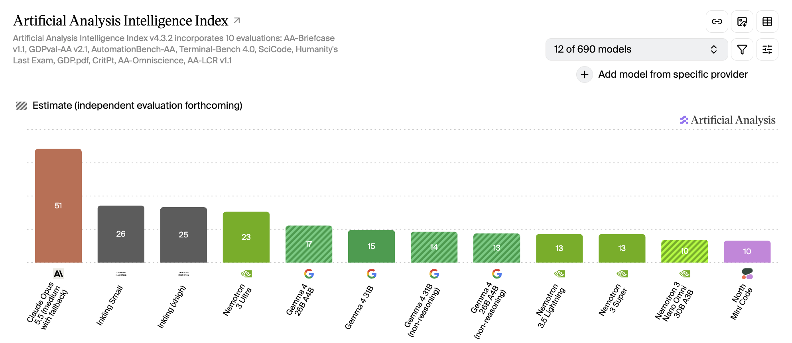

# Autoresearch Workshop

This workshop is to help you understand and use autoresearch at work and in your own projects.

## Autoresearch

Autoresearch is a technique created by Andrej Karpathy for training models. [link](https://github.com/karpathy/autoresearch)

However, the same approach can be used to optimize basically anything that has a measurable goal. Tobias Lutke, of Shopify fame, created a plugin for pi that uses this technique, but other autoresearch plugins exist for other harnesses as well:

- [davebcn87/pi-autoresearch](https://github.com/davebcn87/pi-autoresearch)
- [drivelineresearch/autoresearch-claude-code](https://github.com/drivelineresearch/autoresearch-claude-code)
- [moedesux/autoresearch-opencode](https://github.com/moedesux/autoresearch-opencode)
- [uditgoenka/autoresearch](https://github.com/uditgoenka/autoresearch)(Claude, OpenCode, Codex)

This workshop will focus on using [pi-autoresearch](https://github.com/davebcn87/pi-autoresearch). But you can use any one you want, I just won't be able to help as much with troubleshooting.

## Requirements

Before the workshop begins you may want to have a few things installed to save time and keep from overloading the Wi-fi network.

### NodeJS

This workshop will be focused on JS projects for the time being. You will need NodeJS installed.

See instructions for your platform at [https://nodejs.org/en/download/](https://nodejs.org/en/download/)

#### PNPM recommended

NodeJS ships with NPM by default, but this repo is set up to use PNPM. If you don't want to use PNPM, you can still use NPM, but you will need to handle installing dependencies for the demo-projects individually.

PNPM setup: [https://pnpm.io/installation](https://pnpm.io/installation)

> Note: You may want to perform an NPM/PNPM install of demo-project dependencies before the workshop.

### Pi Coding Agent

Pi is a minimal, extensible agent harness that you can make your own.

Make sure `pi` is installed and updated. If you don't have it installed you can run:

```bash
#curl
curl -fsSL https://pi.dev/install.sh | sh

# npm
npm install -g --ignore-scripts @earendil-works/pi-coding-agent

# pnpm
pnpm add -g --ignore-scripts @earendil-works/pi-coding-agent

# bun
bun add -g --ignore-scripts @earendil-works/pi-coding-agent

# powershell
powershell -c "irm https://pi.dev/install.ps1 | iex"
```

### pi-autoresearch

This workshop focuses on using `pi-autoresearch`.

To install the pi-plugin, you can run:

```bash
pi install npm:pi-autoresearch
```

### Get Access to Open Models

The goal of this workshop is to get you into autoresearch with open weight models using free/cheap providers or local models. There are a few providers you can use for this.

- [OpenRouter](https://openrouter.ai) (Free but limited model choice)
- [Ollama Cloud](https://ollama.com/pricing) (Free but limited model choice) or ($20/mo)
- [OpenCode Go](https://opencode.ai/go) ($10/mo)
- Local hosting (Ollama, LMStudio, etc)

### OpenRouter

OpenRouter has a very large selection of models to use, but a much more limited set of free models. You can sign up for a free account at [https://openrouter.ai](https://openrouter.ai) and use their [free models](https://openrouter.ai/models?variant=free&output_modalities=text).

#### OpenRouter Recommended Models

OpenRouter, at the time of this writing, has around 16 free models to choose from. However, some are not suited well to coding tasks. It is not recommended to use paid API-token-priced models from OpenRouter for this workshop.

For the sake of this workshop, I recommend looking at the following models:

- nvidia/nemotron-3.5-lightning:free
- cohere/north-mini-code:free
- apodex/apodex-1.1-mini:free
- dots-studio/dots-3-note-preview:free
- thinkingmachines/inkling-small:free
- poolside/laguna-xs-2.1:free
- google/gemma-4-26b-a4b-it:free



These models are not the most intelligent models. But, the case to be made in this workshop is that absolute intelligence is not as important when you can just loop a model on optimizing a score.

#### Configuring Pi for OpenRouter (/login)

1. Run `pi`
2. Type `/login`
3. Select `Sign in with an API key`
4. Select `OpenRouter` from the list
5. Enter your API key

#### Configuring Pi for OpenRouter (manually)

You will need to create an API key and save it in your environment variables before running pi.

You can also save the API key in `~/.pi/agent/auth.json`.

```json
{
  "openrouter": {
    "type": "api_key",
    "key": "sk-or-your-key-here"
  }
}
```

### Ollama Cloud

Sign up for a free account at [https://signin.ollama.com/sign-up](https://signin.ollama.com/sign-up)

The free usage credits seem to be:

- 2M tokens per 5 hour session
- 4M tokens per weekly session.

#### Ollama Cloud Free Model Choices

- `gemma4:31b`
- `nemotron-3-nano:30b`
- `nemotron-3-super`
- `nemotron-3-ultra`
- `gpt-oss:20b`
- `gpt-oss:120b`

#### Configuring Pi for Ollama Cloud

1. Install Ollama: [https://ollama.com/docs/install](https://ollama.com/docs/install)
2. Sign into Ollama: `ollama signin`
3. Download a cloud model: `ollama pull gemma4:31b-cloud`
4. Start pi with ollama: `ollama launch pi --config`
5. Select the installed cloud model
6. Select Yes to launch pi

### Local Models via Ollama

Local models are an option if your device is capable of running them. Ollama is a great choice for this.

> Note:If you want to use LMStudio or another local model tool, you will need to find instructions for that yourself.

#### Recommended Local Models via Ollama

Some models have multiple parameter sizes. Pick one that will fit within your GPU's RAM budget.

- ornith-1.5
- muse-glimmer
- nemotron-3.5-lightning
- granite4.2
- gemma4
- glm-4.7-flash
- qwen3.8

#### Configuring Pi for Ollama Local Models

1. Install Ollama: [https://ollama.com/docs/install](https://ollama.com/docs/install)
2. Sign into Ollama: `ollama signin`
3. Download a local model: `ollama pull gemma4:31b`
4. Start pi with ollama: `ollama launch pi --config`
5. Select the installed local model
6. Select Yes to launch pi

## Demo Projects

`demo-projects/` contains target projects for autoresearch sessions. Each one is a small
application with a deliberate performance ceiling, a low-noise metric, a correctness
gate, and instrumentation that makes its bottleneck observable. See
[`demo-projects/README.md`](./demo-projects/README.md) for the shared contract.

| Demo                                                                             | Objective metric (lower is better) | Prerequisite                                                            |
| -------------------------------------------------------------------------------- | ---------------------------------- | ----------------------------------------------------------------------- |
| [`demo-projects/svg-chart`](./demo-projects/svg-chart)                           | `ms`                               | none — plain Node, zero dependencies                                    |
| [`demo-projects/slow-api`](./demo-projects/slow-api)                             | `scenario_ms`                      | none — uses the built-in `node:sqlite` module                           |
| [`demo-projects/bundle-diet`](./demo-projects/bundle-diet)                       | `critical_gzip_kb`                 | Chromium for the boot oracle: `pnpm exec playwright install chromium`   |
| [`demo-projects/datagrid-perf`](./demo-projects/datagrid-perf)                   | `render_ms`                        | none — jsdom and Vitest install with the workspace                      |
| [`demo-projects/canvas-particles`](./demo-projects/canvas-particles)             | `total_ms`                         | none — `@napi-rs/canvas` installs a prebuilt binary                     |
| [`demo-projects/nextjs-core-web-vitals`](./demo-projects/nextjs-core-web-vitals) | `cwv_budget`                       | Chromium (same as `bundle-diet`); run `pnpm run setup` once per machine |

Install the workspace once from the repository root (`pnpm install`). Each demo then
provides `test`, `bench` and `verify` scripts; `pnpm --filter <demo> verify` is the
pre-flight check.

## Fork This Repo

You will likely want to push your work to branches and PRs so you can evaluate the results of your autoresearch sessions.

## Issues/Suggestions

If you run into problems setting up this repo outside of the workshop, please submit issues and/or PRs to this repo directly.

## License

This repo is licensed under the [MIT License](./LICENSE).
