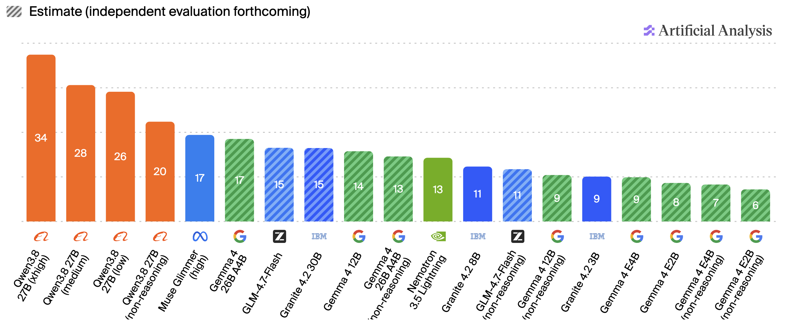
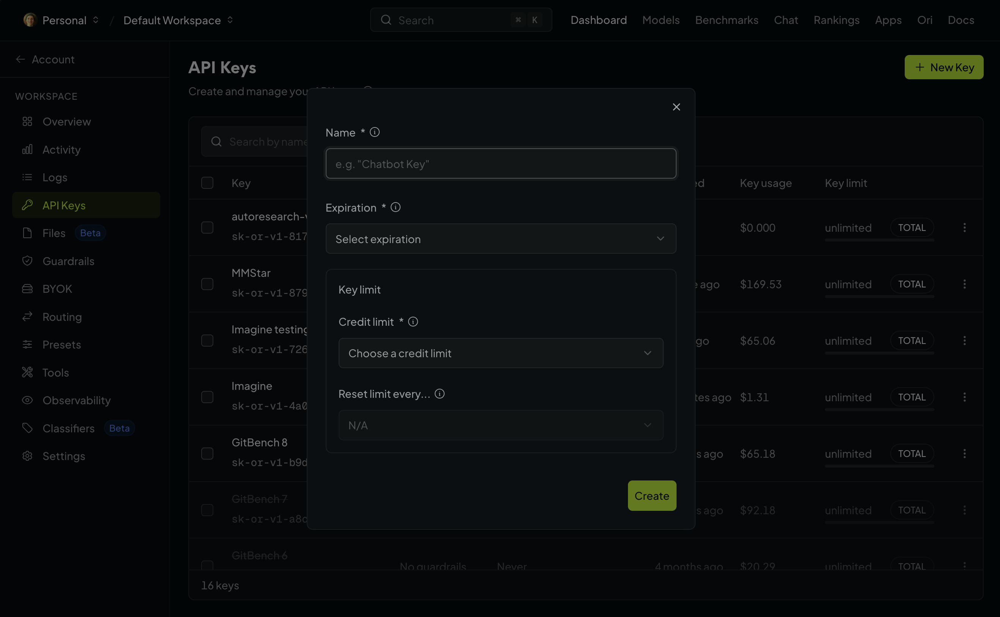

---
# try also 'default' to start simple
theme: default
# random image from a curated Unsplash collection by Anthony
# like them? see https://unsplash.com/collections/94734566/slidev
background: /ousa-chea-gKUC4TMhOiY-unsplash.jpg
# some information about your slides (markdown enabled)
title: Autoresearch Workshop
info: |
  ## Autoresearch Workshop
  A workshop to help you get up and running with pi-autoresearch and open weight models
# apply UnoCSS classes to the current slide
class: text-center
# https://sli.dev/features/drawing
drawings:
  persist: false
# slide transition: https://sli.dev/guide/animations.html#slide-transitions
transition: slide-left
# enable Comark Syntax: https://comark.dev/syntax/markdown
comark: true
# duration of the presentation
duration: 35min
---

# Your First Autoresearch

---
layout: center
class: text-center
---

# Kicking Off an Example Task

---
layout: center
class: text-center
---

# Getting Started

---
layout: quote
---

# Who has parts of their application or side project they would love to optimize for performance?

---
layout: center
class: text-center
---

# The Repo


---

# Requirements

- pi: [https://pi.dev](https://pi.dev)
- pi-autoresearch: [https://github.com/davebcn87/pi-autoresearch](https://github.com/davebcn87/pi-autoresearch)
- openrouter account (free): [https://openrouter.ai](https://openrouter.ai)

---

# Local models as a fallback

- Ollama: [https://ollama.com](https://ollama.com)
- LMStudio: [https://lmstudio.ai](https://lmstudio.ai)

---
layout: two-cols-header
---

# Ollama Local Recommended Models

::left::

- Ornith 1.5
  - ornith-1.5:9b - 6.6GB
  - ornith-1.5:35b - 23GB
- Muse Glimmer
  - muse-glimmer:30b - 18GB
- Nemotron 3.5 Lightning
  - nemotron-3.5-lightning:30b - 25GB
- IBM Granite 4.2
  - granite4.2:3b - 2.2GB
  - granite4.2:8b - 5.3GB
  - granite4.2:30b - 18GB

::right::

- Google Gemma4
  - gemma4:e2b - 4.6GB - 7.3GB
  - gemma4:e4b - 6.6GB - 9.5GB
  - gemma4:12b - 7.7GB - 8.0GB
  - gemma4:26b - 16GB - 19GB
  - gemma4:31b - 19GB - 20GB
- GLM 4.7 Flash
  - glm-4.7-flash:q4_K_M - 19GB
- Qwen 3.8
  - qwen3.8:27b - 18GB

---
layout: center
class: text-center
---

# Local Models Compared




---
layout: center
class: text-center
---

# Checking in on our example...

---
layout: center
class: text-center
---

# What is autoresearch?

---
layout: center
class: text-center
---

# This is NOT research as in gathering data about a topic

---
layout: image
image: /images/karpathy.png
---

---
layout: quote
---

# **The idea**: give an AI agent a small but real LLM training setup and let it experiment autonomously overnight.


---
layout: image
image: /images/pi-autoresearch.png
---

---
layout: quote
---

# **Works for any optimization target**: test speed, bundle size, LLM training, build times, Lighthouse scores.

---

# Other "implementations"

<p></p>

autoresearch-specific:
- [drivelineresearch/autoresearch-claude-code](https://github.com/drivelineresearch/autoresearch-claude-code)
- [moedesux/autoresearch-opencode](https://github.com/moedesux/autoresearch-opencode)
- [uditgoenka/autoresearch](https://github.com/uditgoenka/autoresearch)(Claude, OpenCode, Codex)

similar:

- /goal in Codex - kind of but not really
- performance-goal in Oh-my-codex: [https://github.com/Yeachan-Heo/oh-my-codex/blob/main/plugins/oh-my-codex/skills/performance-goal/SKILL.md](https://github.com/Yeachan-Heo/oh-my-codex/blob/main/plugins/oh-my-codex/skills/performance-goal/SKILL.md)

---
layout: center
class: text-center
---

# Getting Started (continued)

---

# OpenRouter API Keys

https://openrouter.ai/workspaces/default/keys




---

# Configuring Pi for OpenRouter (/login)

1. Run `pi`
2. Type `/login`
3. Select `Sign in with an API key`
4. Select `OpenRouter` from the list
5. Enter your API key

---

# Configuring Pi for OpenRouter (auth.json)

Edit the `auth.json` file in `~/.pi/agent` with the following:

```json
{
  "openrouter": {
    "type": "api_key",
    "key": "sk-or-v1-..."
  }
}
```

---

# OpenRouter Model Choices

Free models:
- nvidia/nemotron-3.5-lightning:free
- cohere/north-mini-code:free
- apodex/apodex-1.1-mini:free
- dots-studio/dots-3-note-preview:free
- thinkingmachines/inkling-small:free
- poolside/laguna-xs-2.1:free
- google/gemma-4-26b-a4b-it:free

---
layout: center
---


---

# The Demos and What They Optimize For

- bundle-diet: bundle size for frontend code
- canvas-particles: particle animation performance
- checksum: a simple cpu bound checksum task
- datagrid-perf: table/grid rendering
- dbmon-react: react the classic example demo
- slow-api: SQL query/schema optimization
- svg-chart: svg chart rendering

---
layout: center
class: text-center
---

# Get a Demo Going!

---
layout: center
class: text-center
---

# Pitfalls

---
layout: center
class: text-center
---

# Diminishing Returns

Not everything can be optimized further

---
layout: center
class: text-center
---

# pi-autoresearch will run forever

The other autoresearch plugin for Claude/Codex/OpenCode has limits you can give it

---
layout: center
class: text-center
---

# Optimizations are only as good as your benchmarks

If the benchmark isn't realistic, the optimizations could be bad for runtime code

---
layout: center
class: text-center
---

# Checking on our autoresearch again

---
layout: center
class: text-center
---

# Inspecting the results

---
layout: center
class: text-center
---

# Questions?


---
layout: center
class: text-center
---

# Thanks!


