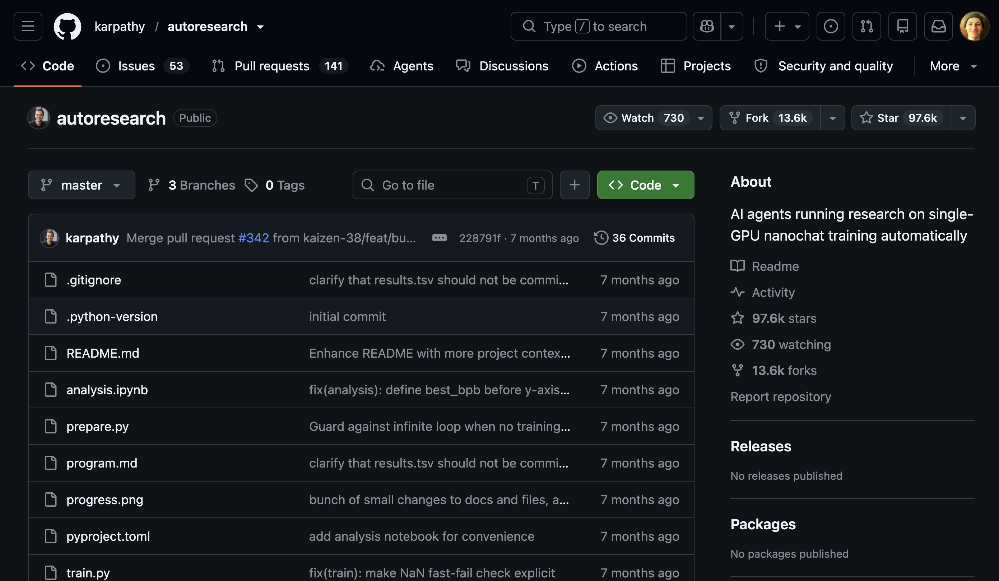
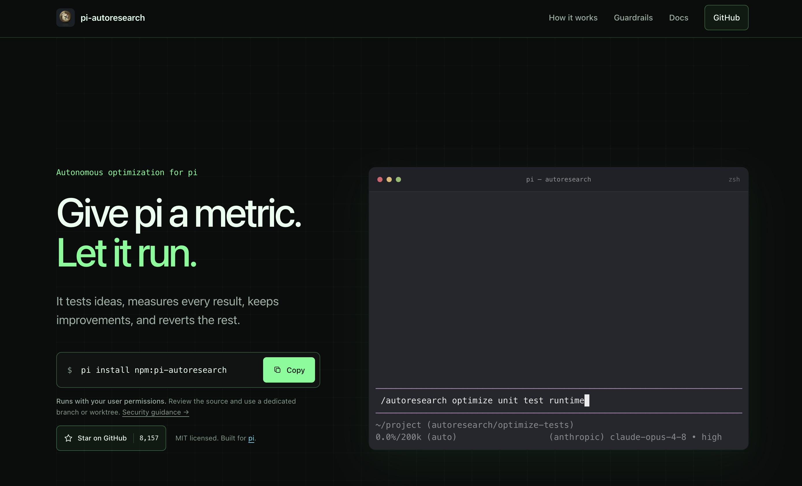

---
# try also 'default' to start simple
theme: ./theme
layout: cover
colorSchema: dark
fonts:
  sans: IBM Plex Sans
  mono: IBM Plex Mono
  local: Archivo,IBM Plex Sans,IBM Plex Mono
  provider: none
# some information about your slides (markdown enabled)
title: Autoresearch Workshop
info: |
  ## Autoresearch Workshop
  A workshop to help you get up and running with pi-autoresearch and open weight models
# apply UnoCSS classes to the current slide
label: Autoresearch workshop
# https://sli.dev/features/drawing
drawings:
  persist: false
# slide transition: https://sli.dev/guide/animations.html#slide-transitions
transition: slide-left
# enable Comark Syntax: https://comark.dev/syntax/markdown
comark: true
# duration of the presentation
duration: 35min
---

# Your First Autoresearch

---
layout: checkpoint
label: Workshop / First experiment
repo: true
---

# Kicking Off an Example Task

---
layout: section
label: 01 / Getting started
---

# Getting Started

---
layout: statement
label: Audience / Your optimization target
class: statement-question
---

# Who has parts of their application or side project they would love to optimize for performance?

---
layout: repository
label: Getting started / repository
---

# The Repo

---
layout: reference
label: Getting started / Requirements
---

# Requirements

<div class="requirements-core">

- pi: [https://pi.dev](https://pi.dev)
- pi-autoresearch: [https://github.com/davebcn87/pi-autoresearch](https://github.com/davebcn87/pi-autoresearch)

</div>

::left::

cloud model provider account (free):

- Openrouter: [https://openrouter.ai](https://openrouter.ai)
- Ollama Cloud: [https://ollama.com](https://ollama.com)

::right::

OR local models:

- Ollama: [https://ollama.com](https://ollama.com)
- LMStudio: [https://lmstudio.ai](https://lmstudio.ai)

---
layout: checkpoint
label: Checkpoint / Example task
repo: true
---

# Checking in on our example...

---
layout: section
label: 02 / The experiment
---

# What is autoresearch?

---
layout: statement
label: Definition / Autoresearch
---

# This is **NOT research** as in gathering data about a topic

---
layout: media
label: Origin / Andrej Karpathy
---

::image::



---
layout: statement
label: The idea / Autonomous experiments
class: statement-long
---

# **The idea**: give an AI agent a small but real LLM training setup and let it experiment autonomously overnight.

---
layout: media
label: Implementation / pi-autoresearch
---

::image::



---
layout: statement
label: Applications / Any optimization target
class: statement-long
---

# **Works for any optimization target**: test speed, bundle size, LLM training, build times, Lighthouse scores.

---
layout: reference
label: Ecosystem / Implementations
class: reference-links
---

# Other "implementations"

::left::

autoresearch-specific:

- [drivelineresearch/autoresearch-claude-code](https://github.com/drivelineresearch/autoresearch-claude-code)
- [moedesux/autoresearch-opencode](https://github.com/moedesux/autoresearch-opencode)
- [uditgoenka/autoresearch](https://github.com/uditgoenka/autoresearch)(Claude, OpenCode, Codex)

::right::

similar:

- /goal in Codex - kind of but not really
- performance-goal in Oh-my-codex: [https://github.com/Yeachan-Heo/oh-my-codex/blob/main/plugins/oh-my-codex/skills/performance-goal/SKILL.md](https://github.com/Yeachan-Heo/oh-my-codex/blob/main/plugins/oh-my-codex/skills/performance-goal/SKILL.md)

---
layout: section
label: 03 / Model setup
---

# Getting Started (continued)

---
layout: media
label: Setup / OpenRouter API keys
---

# OpenRouter API Keys

https://openrouter.ai/workspaces/default/keys

::image::


---
layout: instructions
label: Setup / OpenRouter
---

# Configuring Pi for OpenRouter (/login)

1. Run `pi`
2. Type `/login`
3. Select `Sign in with an API key`
4. Select `OpenRouter` from the list
5. Enter your API key

::note::

> Note: You can use "Sign in with an account" to bring in models from OpenAI, GitHub Copilot, Meta, etc. But the focus of this workshop is open models.

---
layout: instructions
label: Setup / OpenRouter configuration
---

# Configuring Pi for OpenRouter (auth.json)


Edit the `auth.json` file in `~/.pi/agent` with the following:

```json
{
  "openrouter": {
    "type": "api_key",
    "key": "sk-or-v1-..."
  }
}
```

---
layout: reference
label: Models / OpenRouter
class: reference-list
---

# OpenRouter Model Choices


Free models:
- `nvidia/nemotron-3.5-lightning:free`
- `cohere/north-mini-code:free`
- `apodex/apodex-1.1-mini:free`
- `dots-studio/dots-3-note-preview:free`
- `thinkingmachines/inkling-small:free`
- `poolside/laguna-xs-2.1:free`
- `google/gemma-4-26b-a4b-it:free`

---
layout: media
label: Models / OpenRouter free tier
---

::image::


---
layout: reference
label: Models / Ollama Cloud
class: reference-provider
---

# Ollama Cloud (free)


https://ollama.com/pricing

https://signin.ollama.com/sign-up


The free usage credits seem to be: 

- 2M tokens per 5 hour session
- 4M tokens per weekly session.

---
layout: instructions
label: Setup / Ollama Cloud
---

# Configuring Pi for Ollama Cloud

1. Install Ollama: [https://ollama.com/docs/install](https://ollama.com/docs/install)
2. Sign into Ollama: `ollama signin`
3. Download a cloud model: `ollama pull gemma4:31b`
4. Start pi with ollama: `ollama launch pi --config`
5. Select the installed cloud model
6. Select Yes to launch pi

---
layout: reference
label: Models / Ollama Cloud
class: reference-list
---

# Ollama Cloud Free Model Choices

- `gemma4:31b`
- `gpt-oss:120b`
- `gpt-oss:20b`
- `nemotron-3-nano:30b`
- `nemotron-3-super`
- `nemotron-3-ultra`

---
layout: statement
label: Models / Running locally
---

# Ollama Local Works Similarly

Much bigger downloads but more models to choose from

---
layout: reference
label: Local models / download reference
---

# Ollama Local Recommended Models

::left::

<div class="model-group">
<h2>Ornith 1.5</h2>
<div class="model-row"><code>ornith-1.5:9b</code><span class="model-size"> - 6.6GB</span></div>
<div class="model-row"><code>ornith-1.5:35b</code><span class="model-size"> - 23GB</span></div>
</div>
<div class="model-group">
<h2>Muse Glimmer</h2>
<div class="model-row"><code>muse-glimmer:30b</code><span class="model-size"> - 18GB</span></div>
</div>
<div class="model-group">
<h2>Nemotron 3.5 Lightning</h2>
<div class="model-row"><code>nemotron-3.5-lightning:30b</code><span class="model-size"> - 25GB</span></div>
</div>
<div class="model-group">
<h2>IBM Granite 4.2</h2>
<div class="model-row"><code>granite4.2:3b</code><span class="model-size"> - 2.2GB</span></div>
<div class="model-row"><code>granite4.2:8b</code><span class="model-size"> - 5.3GB</span></div>
<div class="model-row"><code>granite4.2:30b</code><span class="model-size"> - 18GB</span></div>
</div>

::right::

<div class="model-group">
<h2>Google Gemma4</h2>
<div class="model-row"><code>gemma4:e2b</code><span class="model-size"> - 4.6GB - 7.3GB</span></div>
<div class="model-row"><code>gemma4:e4b</code><span class="model-size"> - 6.6GB - 9.5GB</span></div>
<div class="model-row"><code>gemma4:12b</code><span class="model-size"> - 7.7GB - 8.0GB</span></div>
<div class="model-row"><code>gemma4:26b</code><span class="model-size"> - 16GB - 19GB</span></div>
<div class="model-row"><code>gemma4:31b</code><span class="model-size"> - 19GB - 20GB</span></div>
</div>
<div class="model-group">
<h2>GLM 4.7 Flash</h2>
<div class="model-row"><code>glm-4.7-flash:q4_K_M</code><span class="model-size"> - 19GB</span></div>
</div>
<div class="model-group">
<h2>Qwen 3.8</h2>
<div class="model-row"><code>qwen3.8:27b</code><span class="model-size"> - 18GB</span></div>
</div>

---
layout: media
label: Local models / Comparison chart
---

# Local Models Compared

::image::


---
layout: reference
label: Workshop / Optimization targets
class: reference-list
---

# The Demos and What They Optimize For

- `bundle-diet`: bundle size for frontend code
- `canvas-particles`: particle animation performance
- `checksum`: a simple cpu bound checksum task
- `datagrid-perf`: table/grid rendering
- `dbmon-react`: react the classic example demo
- `slow-api`: SQL query/schema optimization
- `svg-chart`: svg chart rendering

---
layout: checkpoint
label: Workshop / Your turn
repo: true
---

# Get a Demo Going!

---
layout: section
label: 04 / Pitfalls
---

# Pitfalls

---
layout: statement
label: Pitfalls / Returns
---

# Diminishing Returns

Not everything can be optimized further

---
layout: statement
label: Pitfalls / Stopping
---

# pi-autoresearch will run forever

The other autoresearch plugin for Claude/Codex/OpenCode has limits you can give it

---
layout: statement
label: Pitfalls / Benchmarks
class: statement-long
---

# Optimizations are only as good as **your benchmarks**

If the benchmark isn't realistic, the optimizations could be bad for runtime code

---
layout: checkpoint
label: Checkpoint / Experiment progress
repo: true
---

# Checking on our autoresearch again

---
layout: checkpoint
label: Checkpoint / Review
repo: true
---

# Inspecting the results

---
layout: statement
label: Discussion
---

# Questions?

---
layout: cover
label: Autoresearch workshop / End of session
---

# Thanks!
